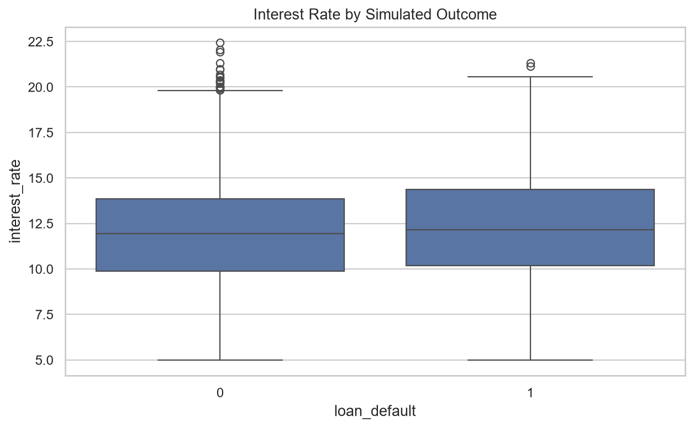
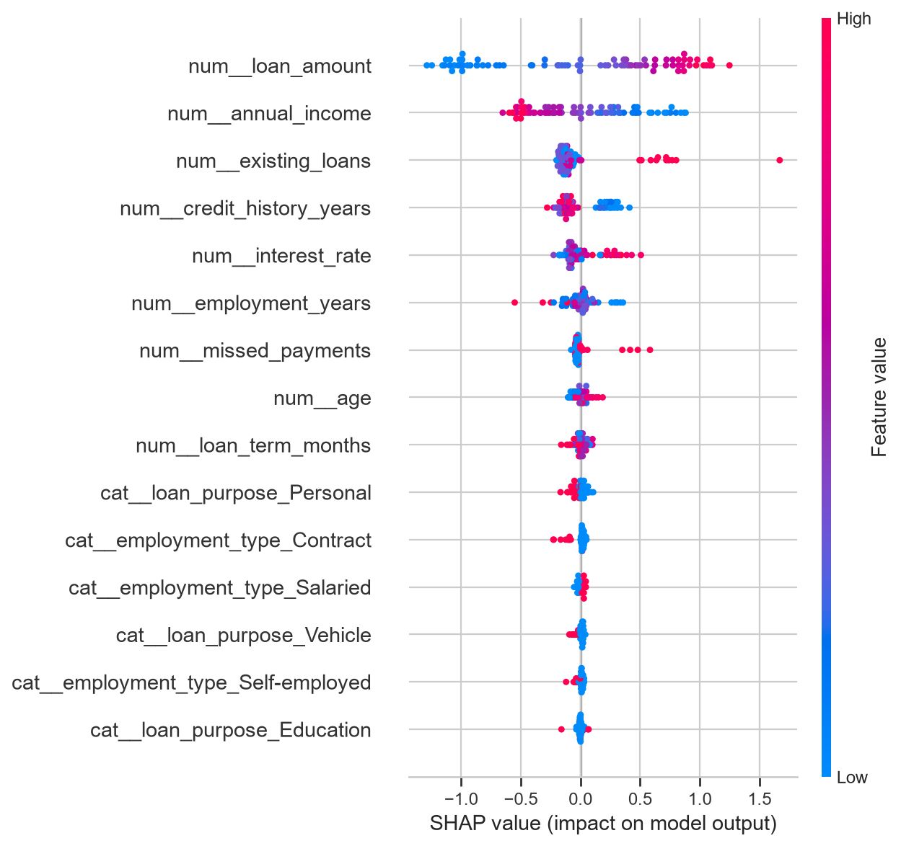

# Credit Risk Assessment & Decision Support System

An end-to-end **Explainable Machine Learning** application for synthetic credit-risk analytics, simulated loan-default prediction, model evaluation, feature-importance analysis, and interactive financial decision support.

> **Responsible Use Notice:** This project uses synthetic applicant and loan data with simulated default labels. Probabilities, metrics, and risk estimates are for analytical demonstration only and are not validated for real-world lending, underwriting, or financial decisions.

---

## Overview

This project implements a complete credit-risk analytics workflow — from data preparation and exploratory analysis to multi-model training, evaluation, explainability, and an interactive Streamlit application.

The system is built around four classification models: **Logistic Regression, Random Forest, XGBoost, and CatBoost**. Their performance is compared on a held-out test set before generating predictions and explainable model insights.

---

## Key Objectives

- Analyze synthetic borrower and loan characteristics
- Perform exploratory data analysis and visualization
- Prepare features for machine-learning classification
- Train and compare four classification models
- Generate simulated loan-default probabilities
- Evaluate model performance using multiple metrics
- Analyze feature importance and model behaviour
- Generate SHAP-based explanations
- Produce reusable CSV, PNG, and model artifacts
- Provide an interactive Streamlit credit-risk analytics dashboard

---

## Project Workflow

```text
Credit Risk Dataset
        ↓
Data Loading & Validation
        ↓
Data Preprocessing
        ↓
Exploratory Data Analysis
        ↓
Feature Preparation
        ↓
Train / Test Split
        ↓
┌─────────────────────────────────────────────┐
│              MODEL TRAINING                 │
│                                             │
│  Logistic Regression  →  Baseline Model     │
│  Random Forest        →  Ensemble Model     │
│  XGBoost              →  Boosting Model     │
│  CatBoost             →  Boosting Model     │
└─────────────────────────────────────────────┘
        ↓
Model Comparison
        ↓
Best Model Selection
        ↓
Default Probability Prediction
        ↓
Model Evaluation
        ↓
Feature Importance Analysis
        ↓
SHAP Explainability
        ↓
Reports & Visualizations
        ↓
╔═════════════════════════════════════════════╗
║       CREDIT RISK ANALYTICS DASHBOARD      ║
║              STREAMLIT APPLICATION         ║
╚═════════════════════════════════════════════╝
```

---

## Dataset

The project uses a synthetic credit-risk dataset containing **5,000 applicant records and 13 columns**.

The target variable is:

```text
loan_default
```

```text
0 → Simulated non-default
1 → Simulated default
```

The dataset contains applicant and loan-related attributes such as age, annual income, employment information, loan amount, loan term, interest rate, credit history, existing loans, missed payments, and loan purpose.

> The dataset is synthetic and intended for analytical demonstration only.

---

## Exploratory Data Analysis

The EDA stage examines the distribution and relationships within the synthetic credit-risk dataset.

### 1. Target Distribution


Shows the distribution of simulated default and non-default observations.

### 2. Annual Income Distribution


Shows the distribution of annual income across synthetic applicants.

### 3. Loan Amount by Outcome


Compares loan-amount distributions across the simulated outcome classes.

### 4. Default Rate by Loan Purpose


Shows simulated default rates across different loan-purpose categories.

### 5. Interest Rate by Outcome



Compares interest-rate distributions across simulated default and non-default observations.

---

## Machine Learning Models

Four classification algorithms are trained and compared within the same workflow.

### Logistic Regression

Provides a transparent linear baseline for the classification task.

### Random Forest

Uses an ensemble of decision trees to capture nonlinear relationships and feature interactions.

### XGBoost

Uses gradient-boosted decision trees for structured/tabular classification.

### CatBoost

Uses gradient boosting as an additional ensemble approach for the classification task.

### Model Artifacts

Trained models are persisted under `models/`:

```text
models/
├── logistic_regression.joblib
├── random_forest.joblib
├── xgboost.joblib
├── catboost.joblib
└── best_model.joblib
```

---

## Model Evaluation

The trained models are evaluated on the held-out test set using accuracy, precision, recall, F1-score, and ROC-AUC.

### Model Comparison

| Model | Accuracy | Precision | Recall | F1-Score | ROC-AUC |
|---|---:|---:|---:|---:|---:|
| CatBoost | 0.764 | 0.415 | 0.074 | 0.126 | **0.683** |
| Logistic Regression | 0.608 | 0.331 | **0.699** | **0.449** | 0.678 |
| Random Forest | 0.722 | 0.391 | 0.384 | 0.388 | 0.673 |
| XGBoost | **0.769** | **0.481** | 0.109 | 0.178 | 0.665 |

These metrics represent the current synthetic-data test split. Different evaluation objectives can lead to different preferred models.

### 6. Model Metrics Comparison


### 7. Best Model Confusion Matrix


Shows the classification results of the selected model on the held-out test set.

### 8. ROC Curves


Compares the ROC behaviour of the trained classification models.

### 9. Precision-Recall Curves


Compares precision and recall behaviour across classification thresholds.

---

## Explainable AI & Feature Importance

Model performance alone is not sufficient for an analytical credit-risk workflow. The project therefore includes feature-importance and SHAP-based analysis.

### 10. Permutation Feature Importance


Measures the change in model performance when individual features are randomly permuted.

### 11. SHAP Summary



Provides an explainable view of how features contribute to model predictions.

> SHAP and feature-importance results describe model behaviour on the synthetic dataset; they do not establish causal relationships.

---

## Credit Risk Analytics — Streamlit Application

The project is delivered through an interactive **Streamlit Credit Risk Analytics** application, providing a single interface for exploring the dataset, estimating applicant risk, reviewing model performance, visualizing analytical results, and downloading generated outputs.

### Application Modules

```text
┌─────────────────────────────────────────────┐
│       CREDIT RISK ANALYTICS APPLICATION     │
├─────────────────────────────────────────────┤
│                                             │
│  Portfolio Overview                         │
│          ↓                                  │
│  Explore Data                               │
│          ↓                                  │
│  Applicant Estimate                         │
│          ↓                                  │
│  Data Visualizations                        │
│          ↓                                  │
│  Model Performance                          │
│          ↓                                  │
│  Reports & Downloads                        │
│                                             │
└─────────────────────────────────────────────┘
```

### Portfolio Overview

Provides a high-level view of the synthetic credit-risk portfolio, including applicant information, simulated default distribution, and dataset-level summaries.

### Explore Data

Allows the dataset to be inspected interactively with filtering and analytical views for loan-purpose and default-rate analysis.

### Applicant Estimate

Provides an interactive interface for entering hypothetical applicant information and obtaining a simulated default-risk estimate from the trained model.

### Data Visualizations

Displays the generated analytical plots directly within the application.

### Model Performance

Provides access to model comparison metrics, confusion-matrix analysis, ROC curves, precision-recall curves, permutation feature importance, and SHAP analysis.

### Reports & Downloads

Provides access to generated CSV reports, prediction files, and visualization outputs.

### Run the Application

```bash
python -m pip install -r requirements.txt
streamlit run app.py
```

The application opens through the local Streamlit server. A local `localhost` address is not a public deployment URL.

---

## Project Outputs

The project generates reusable analytical artifacts under `outputs/`.

| Output | Purpose |
|---|---|
| `model_comparison.csv` | Model evaluation results |
| `best_model_summary.json` | Selected model summary |
| `data_quality_report.csv` | Dataset quality analysis |
| `descriptive_statistics.csv` | Dataset descriptive statistics |
| `permutation_feature_importance.csv` | Feature importance results |
| `shap_feature_importance.csv` | SHAP feature importance results |
| `predictions_*.csv` | Model predictions and probabilities |
| `train_set.csv` | Training data artifact |
| `test_set.csv` | Held-out test data artifact |
| `plots/` | Generated analytical visualizations |
| `reports/` | Generated project reports |

---

## Technology Stack

| Area | Technology |
|---|---|
| Programming | Python |
| Data Processing | Pandas, NumPy |
| Machine Learning | Scikit-learn |
| Classification | Logistic Regression, Random Forest |
| Gradient Boosting | XGBoost, CatBoost |
| Explainable AI | SHAP |
| Visualization | Matplotlib, Seaborn |
| Model Persistence | Joblib |
| Web Application | Streamlit |
| Development | VS Code |
| Version Control | Git & GitHub |

---

## Repository Structure

```text
credit-risk-assessment-and-decision-system/
│
├── data/
│   └── credit_risk_dataset.csv
│
├── models/
│   ├── logistic_regression.joblib
│   ├── random_forest.joblib
│   ├── xgboost.joblib
│   ├── catboost.joblib
│   └── best_model.joblib
│
├── outputs/
│   ├── model_comparison.csv
│   ├── best_model_summary.json
│   ├── predictions_catboost.csv
│   ├── predictions_logistic_regression.csv
│   ├── predictions_random_forest.csv
│   ├── predictions_xgboost.csv
│   ├── train_set.csv
│   ├── test_set.csv
│   ├── data_quality_report.csv
│   ├── descriptive_statistics.csv
│   ├── permutation_feature_importance.csv
│   ├── shap_feature_importance.csv
│   ├── reports/
│   └── plots/
│       ├── 01_target_distribution.png
│       ├── 02_annual_income_distribution.png
│       ├── 03_loan_amount_by_outcome.png
│       ├── 04_default_rate_by_purpose.png
│       ├── 05_interest_rate_by_outcome.png
│       ├── 06_model_metrics_comparison.png
│       ├── 07_best_model_confusion_matrix.png
│       ├── 08_roc_curves.png
│       ├── 09_precision_recall_curves.png
│       ├── 10_permutation_feature_importance.png
│       └── 11_shap_summary.png
│
├── app.py
├── app_backup.py
├── main.py
├── requirements.txt
├── .gitignore
└── README.md
```

---

## Installation & Usage

### Clone Repository

```bash
git clone https://github.com/harshaharshu09/credit-risk-assessment-and-decision-system.git
cd credit-risk-assessment-and-decision-system
```

### Install Dependencies

```bash
python -m pip install -r requirements.txt
```

### Run the Machine Learning Pipeline

```bash
python main.py
```

### Launch the Credit Risk Analytics Application

```bash
streamlit run app.py
```

---

## Responsible Use

This system is a synthetic-data analytics and demonstration project. The generated risk probabilities and model metrics must not be interpreted as validated credit decisions.

A production credit-risk platform would require real-world validation, calibration, fairness testing, data governance, security controls, monitoring, regulatory compliance, and appropriate human oversight.

---

## Repository

[Credit Risk Assessment & Decision Support System](https://github.com/harshaharshu09/credit-risk-assessment-and-decision-system)
