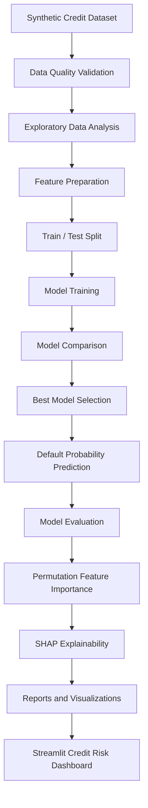

# Credit Risk Assessment & Decision Support System

An end-to-end **Explainable Machine Learning** application for synthetic credit-risk analytics, simulated loan-default prediction, model evaluation, feature-importance analysis, and interactive financial decision support.

> **Responsible Use Notice:** This project uses synthetic applicant and loan data with simulated default labels. Probabilities, metrics, and risk estimates are for analytical demonstration only and are not validated for real-world lending, underwriting, or financial decisions.

---

## Project Summary

This project implements a complete credit-risk analytics workflow, from synthetic dataset preparation through model training, evaluation, explainability, reporting, and interactive application delivery.

The workflow covers:

- Dataset generation and data-quality validation
- Exploratory Data Analysis (EDA)
- Feature preprocessing and train/test split
- Training and comparison of four classification models
- Default-probability prediction for hypothetical applicants
- Evaluation using precision, recall, F1-score, ROC-AUC, and confusion matrix
- Permutation feature importance and SHAP explanations
- Model persistence and downloadable analytical outputs
- Interactive Streamlit dashboard

## Problem

Credit-risk analysis considers multiple applicant and loan attributes that may be associated with the likelihood of repayment difficulty. This project uses those attributes to demonstrate classification and model interpretation on a synthetic dataset.

The target variable is `loan_default`:

```text
0 = Simulated non-default
1 = Simulated default
```

The data is fictional and created using illustrative rules. Model performance on this dataset should not be interpreted as evidence of real-world creditworthiness.

## Dataset

The generated dataset contains **5,000 synthetic applicant records** and **13 columns**. The tracked data-quality report shows zero missing cells.

Features include age, annual income, employment years and type, loan amount, loan term, interest rate, credit history, existing loans, missed payments, and loan purpose. The target column is `loan_default`.

The generated CSV is available at:

```text
data/credit_risk_dataset.csv
```

## Workflow



## Data Preparation

The pipeline performs dataset inspection, missing-value and duplicate checks, feature preparation, categorical encoding, preprocessing, and a train/test split before model evaluation.

The train and test artifacts are available as:

- `outputs/train_set.csv`
- `outputs/test_set.csv`

## Exploratory Data Analysis

The project generates plots to inspect the synthetic default target, applicant income, loan amounts, loan-purpose default rates, and interest rates by simulated outcome.

### Target Distribution


The target distribution shows the counts for simulated non-default and default records.

### Annual Income Distribution


The income distribution helps inspect the range and concentration of synthetic applicant income.

### Loan Amount by Simulated Outcome


This plot compares the distribution of loan amounts across the two simulated target classes.

### Simulated Default Rate by Loan Purpose


This chart compares the synthetic default share across the available loan-purpose categories.

### Interest Rate by Simulated Outcome


This chart compares interest-rate distributions for simulated default and non-default records.

All chart files are stored in `outputs/plots/`.

## Models

Four classification models are implemented and compared:

### Logistic Regression

A baseline classifier that provides a reference point for the model comparison.

### Random Forest

An ensemble of decision trees that can learn nonlinear relationships in structured data.

### XGBoost

A gradient-boosting classifier used to compare boosted-tree performance on the prepared features.

### CatBoost

A gradient-boosting classifier included as an additional model for structured/tabular classification.

The trained model artifacts are stored in `models/`:

- `logistic_regression.joblib`
- `random_forest.joblib`
- `xgboost.joblib`
- `catboost.joblib`
- `best_model.joblib`

## Evaluation

The held-out test split is evaluated using multiple metrics. The current committed `outputs/model_comparison.csv` contains these results:

| Model | Accuracy | Precision (Default) | Recall (Default) | F1 (Default) | ROC-AUC |
|---|---:|---:|---:|---:|---:|
| CatBoost | 0.764 | 0.415 | 0.074 | 0.126 | **0.683** |
| Logistic Regression | 0.608 | 0.331 | **0.699** | **0.449** | 0.678 |
| Random Forest | 0.722 | 0.391 | 0.384 | 0.388 | 0.673 |
| XGBoost | **0.769** | **0.481** | 0.109 | 0.178 | 0.665 |

**Interpretation:** CatBoost has the highest ROC-AUC in the committed comparison file, while XGBoost has the highest accuracy and Logistic Regression has the highest default-class recall and F1-score. The most suitable model depends on the evaluation objective; accuracy alone is not sufficient.

These are results from the current synthetic-data test split, not production performance estimates.

### Model Metrics Comparison


### Best Model Confusion Matrix


The confusion matrix shows the best model's predictions against the held-out test labels.

### ROC Curves


ROC curves compare true-positive and false-positive rates across classification thresholds.

### Precision-Recall Curves


Precision-recall analysis is especially relevant when examining performance on the simulated default class.

## Feature Importance & Explainable AI

### Permutation Feature Importance


Permutation importance estimates how much model performance changes when a feature is shuffled. It provides a model-agnostic view of feature usefulness for this evaluation split.

### SHAP Summary


SHAP (SHapley Additive exPlanations) is used to inspect feature contributions to model predictions. The explanation reflects the trained model and synthetic data; it does not establish causality.

## Streamlit Credit Risk Analytics Application

The project includes a Streamlit web application titled **Credit Risk – Explainable Financial Decision Making**.

The dashboard provides six sections:

- **Portfolio Overview** — synthetic applicant summary, default distribution, and dataset preview
- **Explore Data** — loan-purpose filtering, dataset browsing, descriptive statistics, and purpose-level default rates
- **Applicant Estimate** — hypothetical applicant inputs and simulated default-probability estimation
- **Data Visualizations** — generated PNG plot gallery
- **Model Performance** — model comparison metrics, confusion matrix, ROC curve, precision-recall curve, feature importance, and SHAP summary
- **Reports & Downloads** — downloadable CSV and PNG outputs

### Run the Application Locally

```bash
python -m pip install -r requirements.txt
streamlit run app.py
```

The app runs on the local Streamlit server. **A local address such as `localhost:8503` is not a public live-demo URL.** No public deployment URL is claimed in this README.

## Project Outputs

Generated analytics are stored in `outputs/`. The Streamlit dashboard makes available CSV reports and PNG plots for download.

| Output | Description |
|---|---|
| `outputs/model_comparison.csv` | Test-set metrics for the four classifiers |
| `outputs/best_model_summary.json` | Selected model and its metrics |
| `outputs/data_quality_report.csv` | Per-column data types, missing counts, and unique values |
| `outputs/descriptive_statistics.csv` | Descriptive statistics for the dataset |
| `outputs/permutation_feature_importance.csv` | Permutation importance results |
| `outputs/shap_feature_importance.csv` | SHAP feature importance, when generated |
| `outputs/predictions_*.csv` | Test-set predictions and probabilities by model |
| `outputs/train_set.csv`, `outputs/test_set.csv` | Training and held-out test records |
| `outputs/reports/` | Build verification and model-specific reports |
| `outputs/plots/` | Eleven PNG plots generated by the current pipeline |

## Repository Structure

```text
credit-risk-assessment-and-decision-system/
├── README.md
├── app.py
├── app_backup.py
├── main.py
├── requirements.txt
├── .gitignore
├── credit_risk_dataset.csv
├── data/
│   └── credit_risk_dataset.csv
├── models/
│   ├── best_model.joblib
│   ├── catboost.joblib
│   ├── logistic_regression.joblib
│   ├── random_forest.joblib
│   └── xgboost.joblib
└── outputs/
    ├── best_model_summary.json
    ├── data_quality_report.csv
    ├── descriptive_statistics.csv
    ├── model_comparison.csv
    ├── permutation_feature_importance.csv
    ├── predictions_catboost.csv
    ├── predictions_logistic_regression.csv
    ├── predictions_random_forest.csv
    ├── predictions_xgboost.csv
    ├── shap_feature_importance.csv
    ├── target_distribution.csv
    ├── test_set.csv
    ├── train_set.csv
    ├── reports/
    └── plots/
        ├── 01_target_distribution.png
        ├── 02_annual_income_distribution.png
        ├── 03_loan_amount_by_outcome.png
        ├── 04_default_rate_by_purpose.png
        ├── 05_interest_rate_by_outcome.png
        ├── 06_model_metrics_comparison.png
        ├── 07_best_model_confusion_matrix.png
        ├── 08_roc_curves.png
        ├── 09_precision_recall_curves.png
        ├── 10_permutation_feature_importance.png
        └── 11_shap_summary.png
```

## Technology Stack

| Area | Technology |
|---|---|
| Programming | Python |
| Data Processing | Pandas, NumPy |
| Machine Learning | Scikit-learn |
| Gradient Boosting | XGBoost, CatBoost |
| Explainable AI | SHAP |
| Visualization | Matplotlib, Seaborn |
| Model Persistence | Joblib |
| Interactive Dashboard | Streamlit |
| Version Control | Git |
| Repository Hosting | GitHub |

## Project Setup

Clone the repository:

```bash
git clone https://github.com/harshaharshu09/credit-risk-assessment-and-decision-system.git
cd credit-risk-assessment-and-decision-system
```

Install dependencies:

```bash
python -m pip install -r requirements.txt
```

Run the machine-learning pipeline:

```bash
python main.py
```

Launch the dashboard:

```bash
streamlit run app.py
```

## Reproducibility

The project uses a fixed random seed in the synthetic data generation and model workflow. Running `main.py` regenerates the dataset, models, evaluation reports, and PNG plots in the local project directories. Since data and target labels are simulated, repeatable results describe this artificial setup only.

## Limitations & Responsible Use

- The dataset and target labels are synthetic.
- Results do not establish real-world credit-risk performance.
- The dashboard's 50% classification cutoff is illustrative and is not a validated lending policy.
- SHAP and permutation importance describe model behaviour; they do not prove causal relationships.
- The application is not connected to a live banking or lending system.
- Production use would require appropriate real-world validation, calibration, fairness assessment, monitoring, security controls, and regulatory review.

## Repository

[Credit Risk Assessment & Decision Support System on GitHub](https://github.com/harshaharshu09/credit-risk-assessment-and-decision-system)
