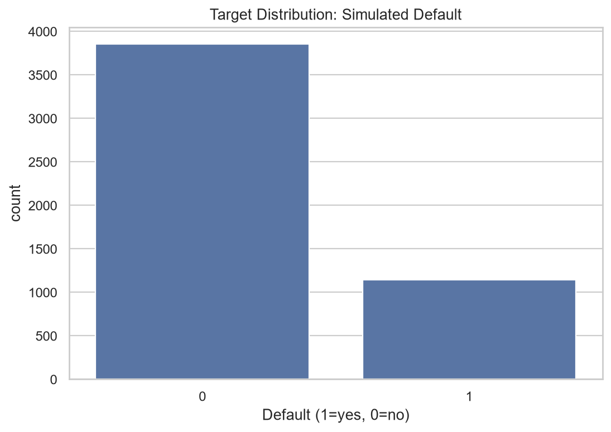
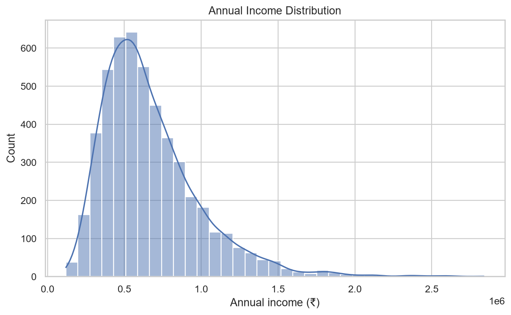
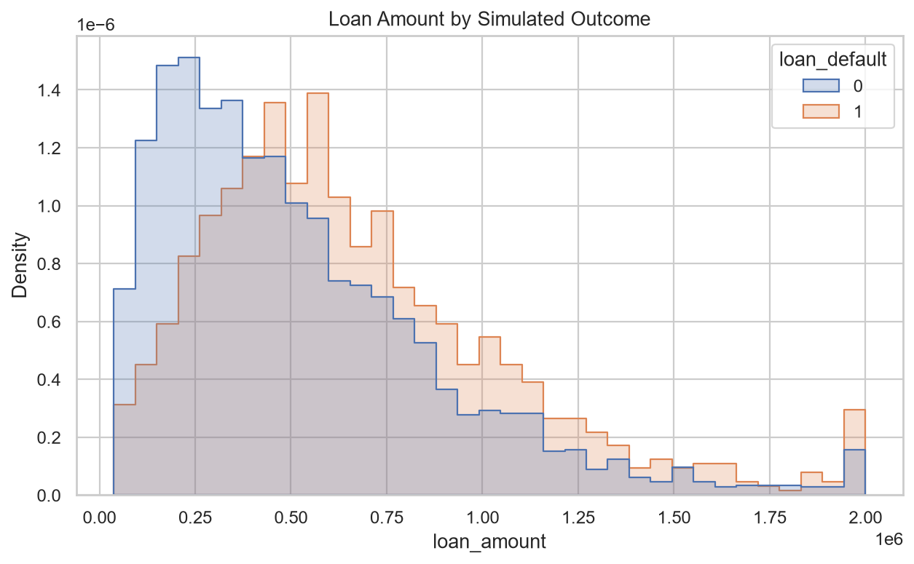
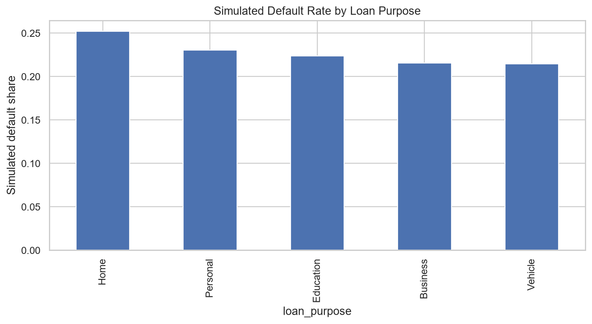
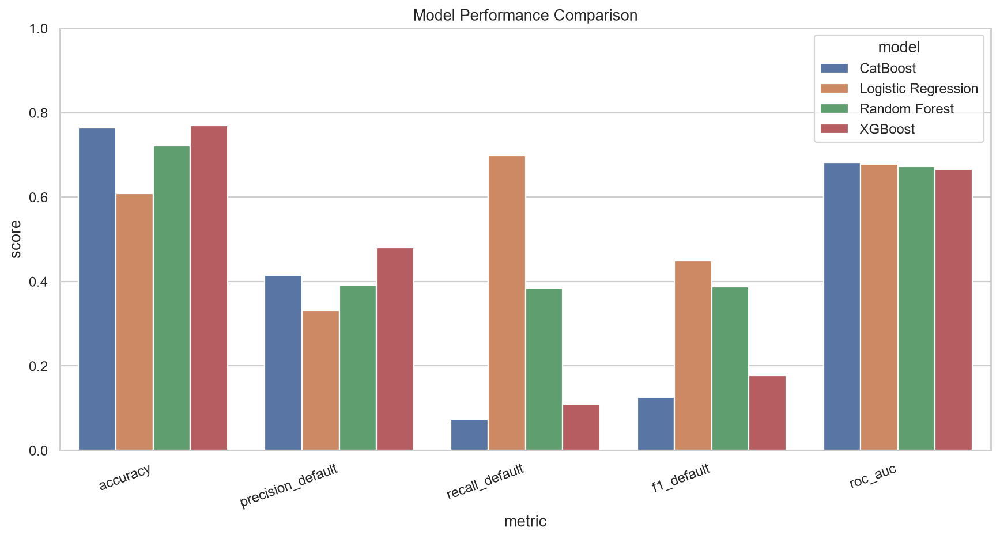
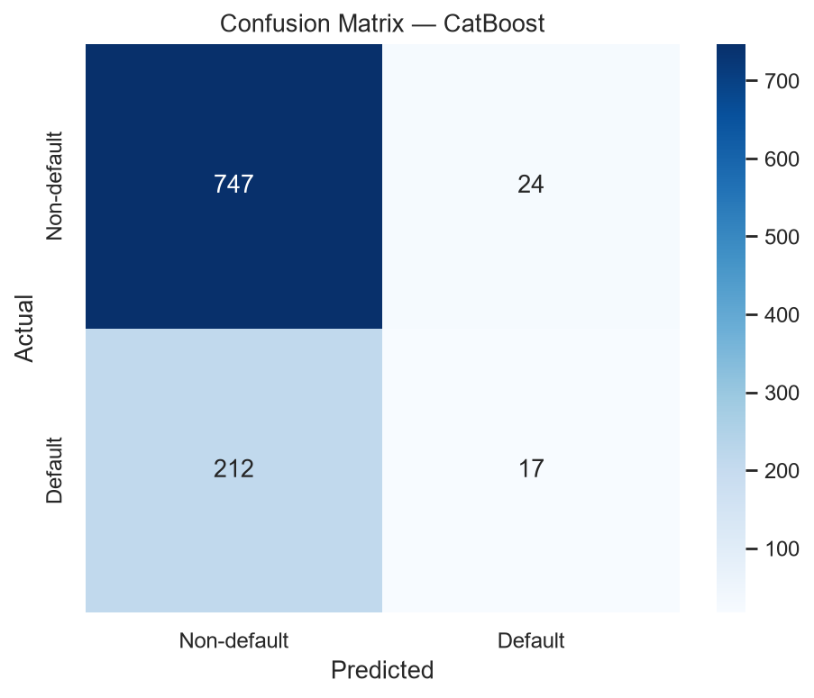
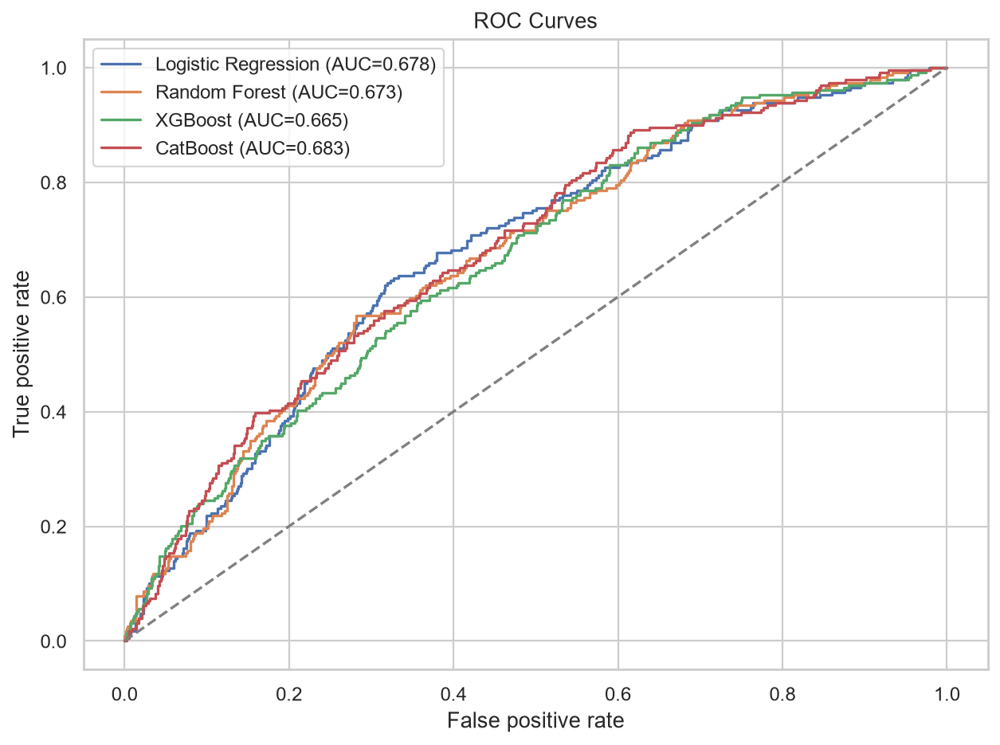
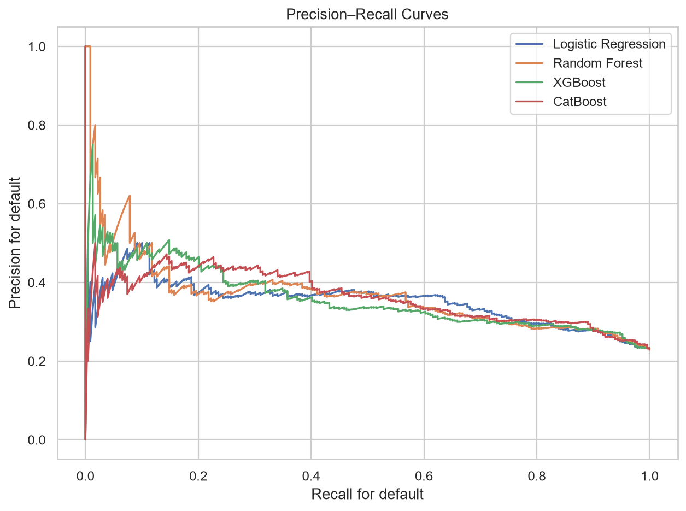
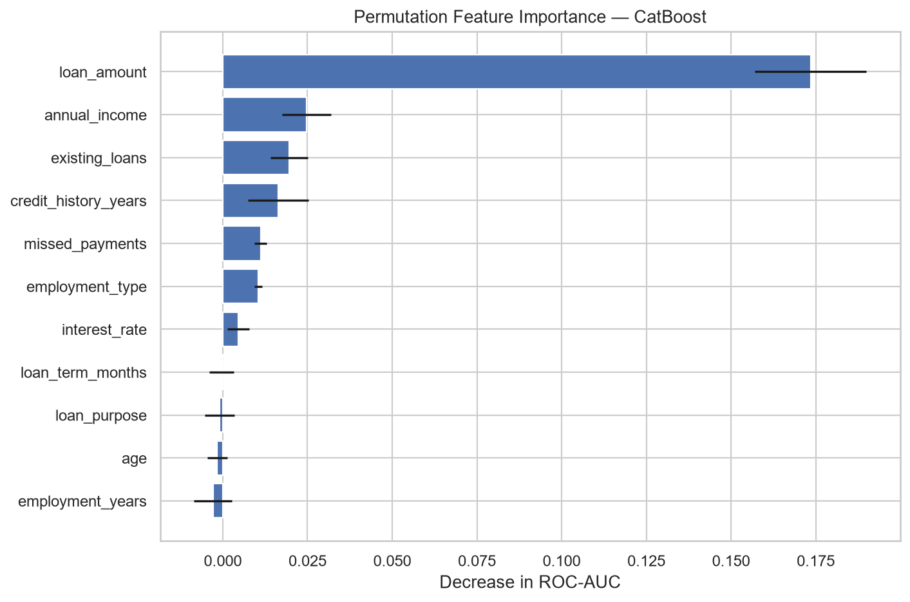

# Credit Risk – Explainable Financial Decision Making

An educational end-to-end ML project using a **synthetic fictional loan dataset**.

> **Important:** The data and labels are simulated, not real customer records. Scores reflect the artificial rules used to create the data and are not evidence of real-world lending performance. Do not use this project for actual loan decisions.

## Workflow
1. Generate 5,000 fictional applicant records.
2. Validate data and create quality reports.
3. Perform EDA with Pandas, Matplotlib and Seaborn.
4. Split training and test data before preprocessing.
5. Compare Logistic Regression, Random Forest, XGBoost and CatBoost when installed.
6. Evaluate accuracy, precision, recall, F1 and ROC-AUC.
7. Save predictions, models, charts and reports.
8. Attempt SHAP explanations.
9. Explore the Streamlit dashboard.

## Target
`loan_default`: 1 = simulated default, 0 = simulated non-default.

## Model comparison
```text
              model  accuracy  precision_default  recall_default  f1_default  roc_auc
           CatBoost     0.764              0.415           0.074       0.126    0.683
Logistic Regression     0.608              0.331           0.699       0.449    0.678
      Random Forest     0.722              0.391           0.384       0.388    0.673
            XGBoost     0.769              0.481           0.109       0.178    0.665
```
Best model by holdout ROC-AUC: **CatBoost**.

## Visualizations










## Structure
```text
Credit_risk/
├── main.py
├── app.py
├── requirements.txt
├── README.md
├── data/credit_risk_dataset.csv
├── models/*.joblib
└── outputs/
    ├── plots/*.png
    ├── reports/*
    ├── model_comparison.csv
    ├── predictions_*.csv
    └── train_set.csv / test_set.csv
```

## Run
```bash
python -m pip install -r requirements.txt
python main.py
streamlit run app.py
```

## Limitations
Synthetic data is designed from illustrative assumptions; metrics can be optimistic. No claim of fairness, causality, calibration, or real-world validity is made. The 50% classification cutoff in the dashboard is illustrative, not a validated policy.
